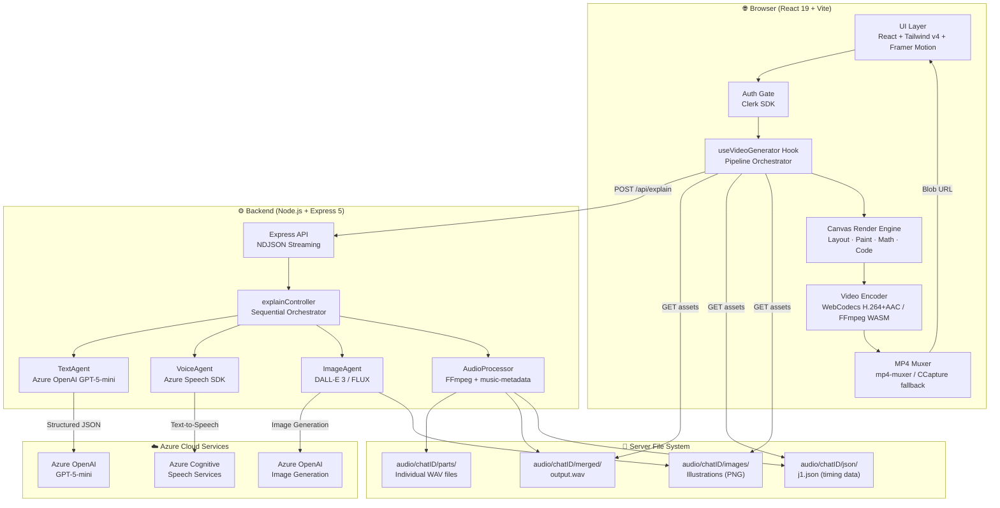
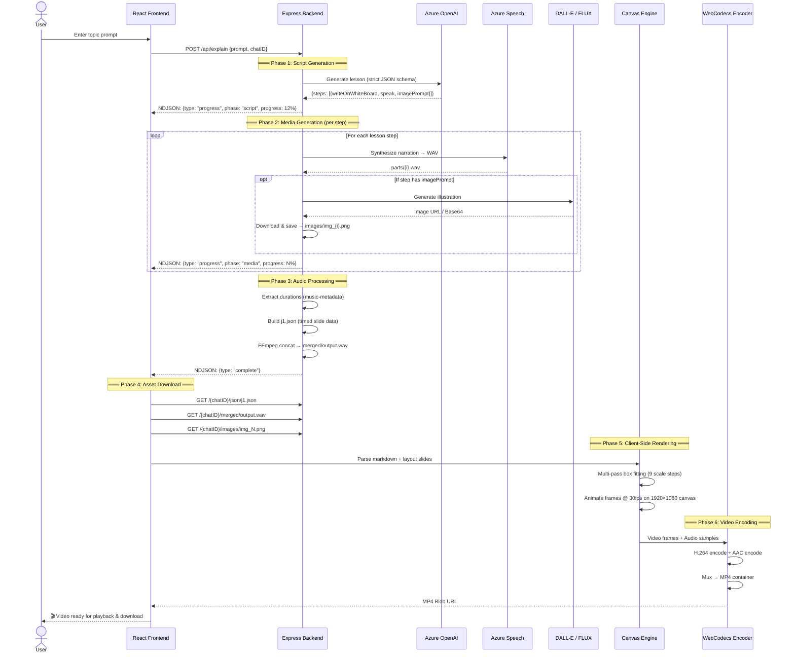
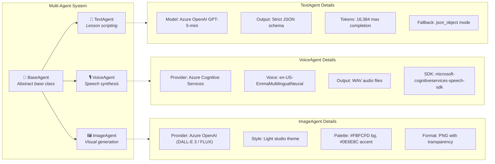
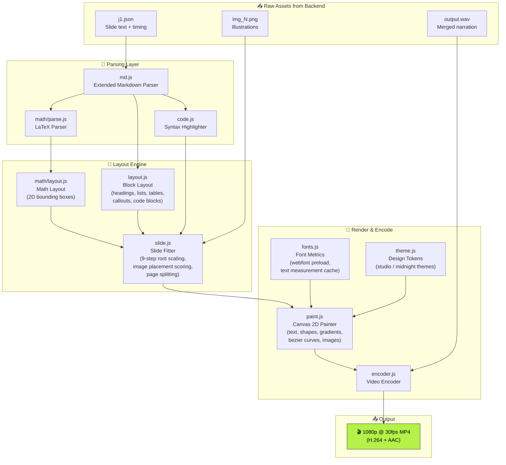

<p align="center">
  
</p>

<h1 align="center">🎬 Xplainer</h1>

<p align="center">
  <strong>AI-powered explainer-video studio that turns any topic into a narrated, illustrated 1080p MP4 — rendered entirely inside your browser.</strong>
</p>

<p align="center">
  
  
  
  
  
  
  
  
</p>

<br />

---

## 📖 Table of Contents

- [Overview](#-overview)
- [Key Features](#-key-features)
- [System Architecture](#-system-architecture)
- [End-to-End Generation Flow](#-end-to-end-generation-flow)
- [Multi-Agent AI Pipeline](#-multi-agent-ai-pipeline)
- [Client-Side Rendering Engine](#-client-side-rendering-engine)
- [Tech Stack](#-tech-stack)
- [Project Structure](#-project-structure)
- [API Reference](#-api-reference)
- [Environment Variables](#-environment-variables)
- [Getting Started](#-getting-started)
- [Deployment](#-deployment)
- [Contributing](#-contributing)
- [License](#-license)

---

## 🌟 Overview

**Xplainer** is a full-stack AI explainer-video studio. A user types in any topic — from *"Explain Quantum Entanglement"* to *"How does RSA Encryption work?"* — and the platform generates a complete, narrated, illustrated whiteboard-style explainer video in MP4 format.

### What makes Xplainer unique?

> **Zero server-side video rendering.**  
> The Node.js backend generates structured lesson scripts (Azure OpenAI), synthesizes voice narration (Azure Neural TTS), and creates illustrations (DALL-E 3 / FLUX). The client browser then downloads these raw assets and uses a **custom HTML5 Canvas rendering engine** with **hardware-accelerated WebCodecs** (H.264 + AAC → MP4) to compose, animate, and encode the final video — all on the user's GPU. No cloud render farms, no FFmpeg workers on the server.

```
                    ┌────────────────────────────────────────────────┐
   "Explain DNS"    │              Xplainer Backend                  │
   ─────────────►   │  Azure OpenAI ──► Script + Image Prompts       │
                    │  Azure Speech ──► Neural Voice WAV Files        │
                    │  DALL-E/FLUX  ──► Contextual Illustrations      │
                    └──────────────────────┬─────────────────────────┘
                                           │ Assets (JSON, WAV, PNG)
                                           ▼
                    ┌────────────────────────────────────────────────┐
                    │              User's Browser                     │
                    │  Canvas Engine ──► Slide Layout & Animation     │
                    │  Math Renderer ──► LaTeX Typesetting            │
                    │  WebCodecs    ──► H.264 + AAC Encoding          │
                    │  mp4-muxer   ──► Final MP4 Container            │
                    └──────────────────────┬─────────────────────────┘
                                           │
                                           ▼
                                   📹 1080p @ 30fps MP4
```

---

## ✨ Key Features

| Feature | Description |
|:--------|:------------|
| **🤖 Multi-Agent AI Pipeline** | Coordinated `TextAgent` → `VoiceAgent` → `ImageAgent` pipeline powered by Azure OpenAI GPT-5-mini, Azure Neural TTS, and DALL-E 3 / FLUX |
| **🎨 Browser-Side Video Rendering** | Custom Canvas 2D engine with mathematical typesetting, syntax highlighting, and slide animations — all client-side |
| **⚡ Hardware-Accelerated Encoding** | WebCodecs H.264 video + AAC audio encoding via GPU, with automatic WASM FFmpeg fallback for legacy browsers |
| **📐 LaTeX Math Support** | Full LaTeX math rendering (`$inline$` and `$$display$$`) with proper typesetting for fractions, matrices, integrals, and Greek symbols |
| **💻 Syntax-Highlighted Code** | Single-pass tokenizer supporting JavaScript, TypeScript, Python, C/C++, Java, SQL, Rust, Go, Bash, and CSS |
| **🔐 Clerk Authentication** | Complete auth flow with SSO, session management, protected routes, and themed UI components |
| **🌓 Dark / Light Mode** | System-aware theme with persistent preference and synchronized Clerk component styling |
| **📱 Responsive Design** | Mobile-first layout with collapsible sidebar, drawer navigation, and adaptive breakpoints |
| **📊 Real-time Progress** | NDJSON streaming with smooth lerp-interpolated progress bar across 6 generation phases |
| **🎯 Overflow-Safe Layout** | 9-step root font scaling with automatic content pagination — mathematically guarantees no text overflows the 1920×1080 frame |

---

## 🏗 System Architecture



---

## 🔄 End-to-End Generation Flow

The complete lifecycle from user prompt to downloadable MP4:



---

## 🤖 Multi-Agent AI Pipeline

The backend employs a modular **multi-agent architecture** where each agent has a single responsibility:



### Agent Output Schema (TextAgent)

```json
{
  "steps": [
    {
      "writeOnWhiteBoard": "# Quantum Entanglement\n- Two particles share a quantum state\n- Measuring one **instantly** affects the other\n- $|\\Psi\\rangle = \\frac{1}{\\sqrt{2}}(|01\\rangle + |10\\rangle)$",
      "speak": "Imagine you have two coins that are magically linked. No matter how far apart they are, when you flip one and it lands on heads, the other will always land on tails...",
      "imagePrompt": {
        "prompt": "Two glowing particles connected by an ethereal quantum bond across space",
        "artStylePreset": "illustration",
        "artStylePrompt": "clean vector, soft shadows",
        "stylePrompt": "cool off-white background, teal accent highlights"
      }
    }
  ]
}
```

---

## 🖥 Client-Side Rendering Engine

The browser-side rendering pipeline is the heart of Xplainer's cost efficiency:



### Encoding Strategy

| Priority | Engine | Technology | Requirements |
|:---------|:-------|:-----------|:-------------|
| **Primary** | WebCodecs | H.264 (GPU) + AAC → `mp4-muxer` | Modern browser with `VideoEncoder` API |
| **Fallback** | FFmpeg WASM | `@ffmpeg/ffmpeg` + `SharedArrayBuffer` | `Cross-Origin-Embedder-Policy: credentialless` |
| **Legacy** | CCapture | Frame-by-frame canvas capture | Any browser with Canvas 2D |

### Progress Phases & Weights

| Phase | Weight | Range | Description |
|:------|:-------|:------|:------------|
| `script` | 12% | 0% – 12% | AI lesson generation |
| `media` | 43% | 12% – 55% | Voice synthesis + image generation |
| `assets` | 8% | 55% – 63% | Downloading JSON, WAV, and PNGs |
| `compose` | 7% | 63% – 70% | Font verification + text fitting + layout |
| `encode` | 28% | 70% – 98% | Canvas animation + H.264/AAC encoding |
| `done` | 2% | 98% – 100% | MP4 blob finalization |

---

## 🛠 Tech Stack

### Frontend

| Category | Technology | Version |
|:---------|:-----------|:--------|
| **Framework** | React | 19.2.0 |
| **Build Tool** | Vite (SWC) | 7.2.4 |
| **Routing** | React Router DOM | 7.18.2 |
| **Styling** | Tailwind CSS | 4.1.18 |
| **Animation** | Framer Motion | 12.26.1 |
| **Auth** | Clerk React | 5.61.9 |
| **Video Encoding** | mp4-muxer | 5.2.2 |
| **WASM Fallback** | @ffmpeg/ffmpeg | 0.11.6 |
| **Markdown** | markdown-it | 14.1.0 |
| **Icons** | Lucide React | 0.562.0 |

### Backend

| Category | Technology | Version |
|:---------|:-----------|:--------|
| **Runtime** | Node.js (CommonJS) | — |
| **Framework** | Express | 5.1.0 |
| **AI / LLM** | Azure OpenAI (openai SDK) | 4.77.0 |
| **Speech** | Azure Cognitive Services Speech SDK | 1.44.0 |
| **Audio Processing** | fluent-ffmpeg + ffmpeg-static | 2.1.3 / 5.3.0 |
| **Audio Metadata** | music-metadata | 7.14.0 |
| **Process Manager** | PM2 | 6.0.6 |

### Cloud Services

| Service | Usage |
|:--------|:------|
| **Azure OpenAI** | GPT-5-mini for structured lesson generation |
| **Azure Cognitive Services** | Neural TTS voice synthesis (EmmaMultilingualNeural) |
| **Azure OpenAI Images** | DALL-E 3 / FLUX 1.1 pro for illustrations |
| **Azure App Service** | Backend hosting (IIS + iisnode) |
| **Azure Static Web Apps** | Frontend hosting with SPA fallback |

---

## 📂 Project Structure

```
Xplainer/
├── xplainer-frontend/                  # React 19 client application
│   ├── public/
│   │   └── _redirects                  # SPA fallback for Netlify/Cloudflare
│   ├── scripts/
│   │   ├── calibrate-budget.mjs        # Typography bounds measurement
│   │   ├── preview.mjs                 # SVG slide preview generator
│   │   └── verify-render.mjs           # Headless overflow validation
│   ├── src/
│   │   ├── components/
│   │   │   ├── Auth/
│   │   │   │   └── RequireAuth.jsx     # Route guard (redirect if unauthenticated)
│   │   │   ├── Docs/
│   │   │   │   ├── Bits.jsx            # Typography primitives (Section, Callout, etc.)
│   │   │   │   ├── CodeBlock.jsx       # Syntax-highlighted code with copy button
│   │   │   │   ├── DocsNav.jsx         # Sticky TOC with IntersectionObserver
│   │   │   │   └── Visuals.jsx         # Architecture SVG diagrams & charts
│   │   │   ├── Home/
│   │   │   │   ├── Hero.jsx            # Welcome banner with user greeting
│   │   │   │   └── PromptBar.jsx       # Topic input with suggestion pills
│   │   │   ├── Landing/
│   │   │   │   ├── TopNav.jsx          # Sticky marketing navbar
│   │   │   │   ├── ProductFrame.jsx    # Interactive product demo frame
│   │   │   │   ├── Reveal.jsx          # Viewport animation wrapper
│   │   │   │   ├── Faq.jsx             # Animated FAQ accordion
│   │   │   │   └── Footer.jsx          # Site footer with tech badges
│   │   │   ├── Layout/
│   │   │   │   ├── AppShell.jsx        # Authenticated app frame
│   │   │   │   ├── Brand.jsx           # Brand wordmark component
│   │   │   │   ├── Sidebar.jsx         # Navigation sidebar
│   │   │   │   ├── LoadingScreen.jsx   # Animated splash loader
│   │   │   │   └── ThemeToggle.jsx     # Dark/light mode toggle
│   │   │   └── Video/
│   │   │       ├── ProgressOverlay.jsx # Multi-stage progress indicator
│   │   │       ├── VideoCard.jsx       # Video thumbnail with actions
│   │   │       └── VideoPlayer.jsx     # Modal video player
│   │   ├── hooks/
│   │   │   ├── useSignedIn.js          # Clerk auth state resolver
│   │   │   ├── useTheme.js             # Theme persistence & OS sync
│   │   │   ├── useVideos.js            # In-memory video library manager
│   │   │   └── useVideoGenerator.js    # Master pipeline orchestrator
│   │   ├── lib/
│   │   │   └── clerkAppearance.js      # Clerk ↔ Tailwind theme bridge
│   │   ├── pages/
│   │   │   ├── Landing.jsx             # Public marketing landing page
│   │   │   ├── AuthPage.jsx            # Split-screen sign-in/sign-up
│   │   │   ├── Studio.jsx              # Main creation studio
│   │   │   ├── HowItWorks.jsx          # 12-chapter technical docs
│   │   │   ├── SetupNotice.jsx         # Missing env var guide
│   │   │   └── NotFound.jsx            # 404 page
│   │   ├── render/
│   │   │   ├── index.js                # Barrel export
│   │   │   ├── theme.js                # Slide design tokens & colors
│   │   │   ├── fonts.js                # Font metrics & preloading
│   │   │   ├── md.js                   # Extended Markdown → AST parser
│   │   │   ├── code.js                 # Multi-language syntax highlighter
│   │   │   ├── layout.js               # Block layout engine
│   │   │   ├── slide.js                # Slide fitter & page splitter
│   │   │   ├── paint.js                # Canvas 2D draw operations
│   │   │   └── math/
│   │   │       ├── parse.js            # LaTeX → syntax tree parser
│   │   │       └── layout.js           # Math 2D bounding box layout
│   │   ├── video/
│   │   │   └── encoder.js              # WebCodecs / FFmpeg / CCapture encoder
│   │   ├── theme/
│   │   │   ├── context.js              # ThemeContext definition
│   │   │   └── ThemeContext.jsx         # Theme provider component
│   │   ├── main.jsx                    # React root entry point
│   │   ├── App.jsx                     # Router & Clerk gate
│   │   └── index.css                   # Tailwind v4 config & animations
│   ├── index.html                      # Entry HTML with anti-FOUC script
│   ├── vite.config.js                  # Vite + SWC + COOP/COEP headers
│   ├── staticwebapp.config.json        # Azure Static Web Apps config
│   └── package.json
│
├── xplainer-backend/                   # Node.js + Express 5 API server
│   ├── agents/
│   │   ├── BaseAgent.js                # Abstract agent base class
│   │   ├── TextAgent.js                # Azure OpenAI lesson generator
│   │   ├── VoiceAgent.js               # Azure Speech TTS synthesizer
│   │   ├── ImageAgent.js               # DALL-E 3 / FLUX image generator
│   │   └── prompt.js                   # Master system prompt & constraints
│   ├── controllers/
│   │   └── explainController.js        # NDJSON streaming orchestrator
│   ├── routes/
│   │   ├── explainRoutes.js            # POST /explain endpoint
│   │   └── testRoutes.js               # Diagnostics endpoint
│   ├── services/
│   │   └── AudioProcessor.js           # FFmpeg merge + duration extraction
│   ├── audio/                          # Runtime media storage (gitignored)
│   │   └── <chatID>/
│   │       ├── parts/                  # Individual step WAV files
│   │       ├── merged/                 # Concatenated output.wav
│   │       ├── json/                   # Timed slide metadata (j1.json)
│   │       └── images/                 # Downloaded illustrations
│   ├── server.js                       # HTTP server bootstrap
│   ├── app.js                          # Express app, middleware, routes
│   ├── web.config                      # Azure App Service / IIS config
│   ├── nodemon.json                    # Dev watcher ignore patterns
│   └── package.json
│
└── README.md                           # ← You are here
```

---

## 📡 API Reference

### Main Endpoints

#### `POST /api/explain`

Generates a complete explainer video's assets from a topic prompt.

**Request:**
```json
{
  "prompt": "Explain how DNS resolution works",
  "chatID": "abc123-unique-id"
}
```

**Response:** `Content-Type: application/x-ndjson` — Streamed newline-delimited JSON events:

```jsonc
// Progress events (streamed during generation)
{"type": "progress", "phase": "script", "progress": 10, "message": "Generating lesson script..."}
{"type": "progress", "phase": "media",  "progress": 35, "message": "Generating voice & images (3/8)..."}

// Completion event (final)
{"type": "complete", "chatID": "abc123-unique-id"}

// Error event (if failure occurs)
{"type": "error", "message": "Azure OpenAI rate limit exceeded"}
```

---

#### `GET /health`

Health check endpoint for monitoring and load balancers.

```json
{ "status": "ok", "message": "ExplainerAI Backend is running" }
```

---

#### Asset Endpoints

| Method | Endpoint | Description | Content-Type |
|:-------|:---------|:------------|:-------------|
| `GET` | `/:chatId/json/j1.json` | Timed slide metadata with text content and audio durations | `application/json` |
| `GET` | `/:chatId/merged/output.wav` | Concatenated narration audio track | `audio/wav` |
| `GET` | `/:chatId/images/img_N.png` | Generated slide illustration | `image/png` |
| `GET` | `/debug/:chatId` | Debug endpoint inspecting session file structure | `application/json` |

---

### Asset Schema: `j1.json`

```json
[
  {
    "time": 0,
    "content": "# What is DNS?\n- Domain Name System translates names to IPs\n- Acts as the **internet's phonebook**\n- $\\text{google.com} \\rightarrow 142.250.80.46$",
    "duration": 12450
  },
  {
    "time": 12450,
    "content": "# The Resolution Process\n- Browser checks local cache first\n- Recursive resolver queries root servers\n- ",
    "duration": 15230
  }
]
```

---

## 🔐 Environment Variables

### Backend (`xplainer-backend/.env`)

| Variable | Required | Description |
|:---------|:--------:|:------------|
| `PORT` | ○ | Server port (default: `3000`) |
| `FRONTEND_URL` | ○ | Allowed CORS origin (default: `http://localhost:5173`) |
| `BASE_URL` | ○ | Public base URL for asset links |
| `OPENAI_ENDPOINT` | ● | Azure OpenAI resource endpoint |
| `OPENAI_APIKEY` | ● | Azure OpenAI API key |
| `OPENAI_DEPLOYMENT` | ○ | Model deployment name (default: `gpt-5-mini`) |
| `OPENAI_API_VERSION` | ○ | API version (default: `2024-12-01-preview`) |
| `SPEECH_KEY` | ● | Azure Speech Services subscription key |
| `SPEECH_REGION` | ● | Azure Speech region (e.g., `eastus`) |
| `SPEECH_VOICE` | ○ | TTS voice ID (default: `en-US-EmmaMultilingualNeural`) |

### Frontend (`xplainer-frontend/.env`)

| Variable | Required | Description |
|:---------|:--------:|:------------|
| `VITE_SERVER_URL` | ● | Backend API URL (e.g., `http://localhost:3000`) |
| `VITE_CLERK_PUBLISHABLE_KEY` | ● | Clerk publishable key for authentication |

> **●** = Required &nbsp;&nbsp; **○** = Optional

---

## 🚀 Getting Started

### Prerequisites

- **Node.js** ≥ 18.x
- **npm** ≥ 9.x
- **FFmpeg** (bundled via `ffmpeg-static`, no separate install needed)
- **Azure Account** with:
  - Azure OpenAI resource (GPT-5-mini deployment)
  - Azure Cognitive Services Speech resource
  - Azure OpenAI Image Generation (DALL-E 3 or FLUX)
- **Clerk Account** (free tier at [clerk.com](https://clerk.com))

### 1. Clone the Repository

```bash
git clone https://github.com/your-username/Xplainer.git
cd Xplainer
```

### 2. Setup Backend

```bash
cd xplainer-backend
npm install
```

Create `.env` file:

```env
PORT=3000
FRONTEND_URL=http://localhost:5173
BASE_URL=http://localhost:3000

# Azure OpenAI
OPENAI_ENDPOINT=https://your-resource.cognitiveservices.azure.com/
OPENAI_APIKEY=your-azure-openai-key
OPENAI_DEPLOYMENT=gpt-5-mini
OPENAI_API_VERSION=2024-12-01-preview

# Azure Speech
SPEECH_KEY=your-speech-key
SPEECH_REGION=eastus
SPEECH_VOICE=en-US-EmmaMultilingualNeural
```

Start the development server:

```bash
npm run dev
```

### 3. Setup Frontend

```bash
cd xplainer-frontend
npm install
```

Create `.env` file:

```env
VITE_SERVER_URL=http://localhost:3000
VITE_CLERK_PUBLISHABLE_KEY=pk_test_your-clerk-key
```

Start the development server:

```bash
npm run dev
```

### 4. Open the App

Navigate to **http://localhost:5173** — sign in and start generating videos!

---

## ☁️ Deployment

### Backend — Azure App Service

The backend is configured for Azure App Service (Windows) via `web.config` with iisnode:

```bash
# Build and deploy
az webapp up --name xplainer-api --runtime "NODE:18-lts"

# Set environment variables
az webapp config appsettings set --name xplainer-api \
  --settings OPENAI_ENDPOINT=... OPENAI_APIKEY=... SPEECH_KEY=... SPEECH_REGION=...
```

### Frontend — Azure Static Web Apps

The frontend includes `staticwebapp.config.json` for Azure Static Web Apps with:
- SPA navigation fallback to `index.html`
- `Cross-Origin-Opener-Policy: same-origin` headers
- `Cross-Origin-Embedder-Policy: credentialless` headers (required for `SharedArrayBuffer` / FFmpeg WASM)

```bash
# Build production bundle
cd xplainer-frontend
npm run build

# Deploy dist/ to Azure Static Web Apps or any static host
```

> **Important:** The `Cross-Origin-Embedder-Policy: credentialless` header is essential. It enables `SharedArrayBuffer` for the FFmpeg WASM fallback while still allowing third-party scripts (Clerk auth) to load.

### Alternative Platforms

| Platform | Frontend Config | Notes |
|:---------|:---------------|:------|
| **Netlify** | `public/_redirects` included | SPA fallback via `/* /index.html 200` |
| **Cloudflare Pages** | `public/_redirects` included | Same redirect rules apply |
| **Vercel** | Add `vercel.json` with rewrites | Ensure COOP/COEP headers are set |

---

## 🗺 Routing Map

| Route | Access | Page | Description |
|:------|:-------|:-----|:------------|
| `/` | Public | Landing | Marketing page with product demo, features, FAQ |
| `/how-it-works` | Public | HowItWorks | 12-chapter technical architecture documentation |
| `/sign-in/*` | Public | AuthPage | Clerk sign-in with split-screen layout |
| `/sign-up/*` | Public | AuthPage | Clerk sign-up with split-screen layout |
| `/app` | Protected | Studio | Main creation studio with prompt bar |
| `/app/videos` | Protected | Studio | Generated video gallery with playback |
| `/studio` | Redirect | → `/app` | Legacy route alias |
| `*` | Fallback | NotFound | Custom 404 page |

---

## 🤝 Contributing

Contributions are welcome! Here's how to get started:

1. **Fork** the repository
2. **Create** a feature branch: `git checkout -b feature/amazing-feature`
3. **Commit** your changes: `git commit -m 'Add amazing feature'`
4. **Push** to the branch: `git push origin feature/amazing-feature`
5. **Open** a Pull Request

### Development Scripts

**Frontend:**
```bash
npm run dev              # Start Vite dev server
npm run build            # Production build
npm run preview          # Preview production build
npm run lint             # ESLint check
npm run verify:render    # Headless slide overflow test
npm run preview:slides   # Generate SVG slide previews
npm run calibrate        # Typography bounds measurement
```

**Backend:**
https://github.com/abhinavtiwari77/xplainer-backend
```bash
npm run dev              # Start with nodemon (auto-reload)
npm start                # Production start
```


<p align="center">
  Built with ❤️ using Azure AI, React 19, and the WebCodecs API
</p>
